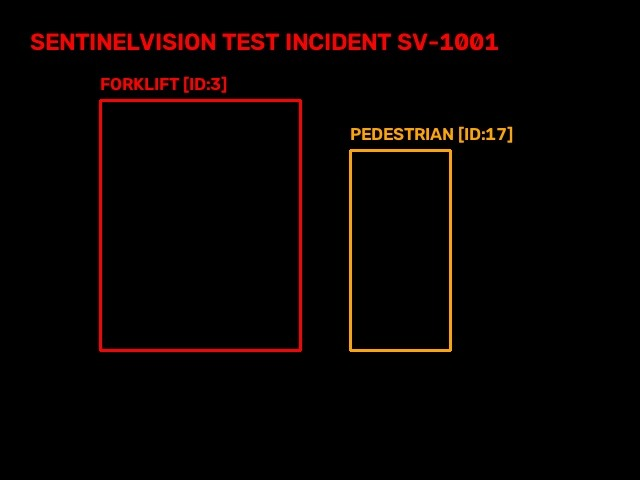

# ☁️ SentinelVision — AWS Architecture Specification

## 1. Edge-First Design Philosophy

SentinelVision operates **edge-first** to ensure sub-100ms camera-to-action response times without dependence on cloud network roundtrips:

```text
                  EDGE INGESTION & AGENT ENGINE
           (OpenCV 5 + YOLOv8 + Risk Engine + Action Loop)
                                 │
                         Safety Event Triggered
                                 │
                                 ▼
                     AWS ECS / FARGATE BACKEND
                                 │
            ┌────────────────────┼────────────────────┐
            ▼                    ▼                    ▼
        AWS S3              AWS DynamoDB        AWS CloudWatch
   (Keyframe Evidence   (Incident Audit Trail  (System Telemetry,
   Image Snapshots)      & Log Database)       FPS & Hazard Metrics)
```

---

## 2. Component Specifications

### A. Edge Engine (Local Compute)
- **Functions**: OpenCV 5 video acquisition, YOLOv8 object detection, IoU multi-object tracking, trajectory extrapolation, TTC prediction, multi-factor risk scoring, and local warning dispatch.
- **Latency**: End-to-end average `94.70 ms` (`10.6 FPS` on CPU).

### B. AWS S3 Evidence Storage
- **Bucket**: `sentinelvision-evidence-snapshots`
- **Objects**: Compressed `.jpg` keyframe snapshots taken at the instant of `HIGH` or `CRITICAL` safety triggers.
- **Lifecycle**: Retained for 90 days for safety compliance and model retraining audit trails.

### C. AWS DynamoDB Incident Audit Database
- **Table**: `SentinelVision_Incidents`
- **Partition Key**: `incident_id` (`String`)
- **Sort Key**: `timestamp` (`Number`)
- **Attributes**: `risk_level`, `person_id`, `vehicle_id`, `ttc`, `action_taken`, `environment`, `resolved`, `resolution_time_sec`, `human_override`.

### D. AWS CloudWatch Real-Time Telemetry
- **Namespace**: `SentinelVision/OperationalMetrics`
- **Metrics Tracked**:
  - `PipelineFPS` (Gauge)
  - `InferenceLatencyMs` (Gauge)
  - `ActiveTrackCount` (Gauge)
  - `HazardsDetectedCount` (Counter)
  - `HazardsResolvedCount` (Counter)
  - `HumanOverridesCount` (Counter)

---

## 3. Verified Live AWS Console Evidence

Authentic live deployment screenshots captured from the AWS Management Console (`us-east-1`, Account ID `550130133606`):

### A. Amazon S3 Incident Storage

*Figure 1: Amazon S3 Management Console displaying live incident trace `incidents/2026/10/SV-1001/trace.json` in bucket `sentinelvision-evidence-550130133606`.*


*Figure 2: Amazon S3 Management Console displaying uploaded JPEG snapshot `incidents/2026/10/SV-1001/snapshot.jpg`.*


*Figure 3: Keyframe frame snapshot uploaded directly by SentinelVision edge pipeline during incident SV-1001 trigger.*

### B. Amazon DynamoDB Incident State Ledger

*Figure 4: Amazon DynamoDB console scan showing live state lifecycle records for incidents `SV-0001` and `SV-1001` with `resolved: true` and recorded resolution durations.*

### C. Amazon CloudWatch Operational Telemetry

*Figure 5: Amazon CloudWatch metrics console graphing live operational telemetry (`PipelineFPS` ~10.6 FPS, `InferenceLatencyMs` ~94.7 ms, `HazardsDetected`, `HazardsResolved`).*

