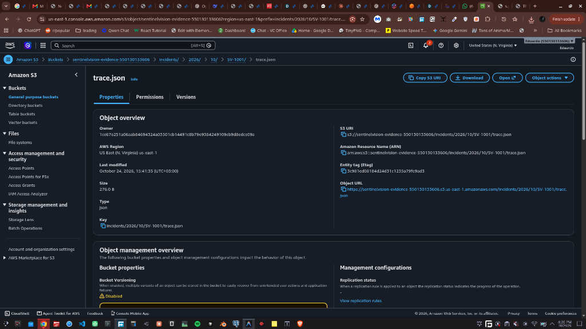
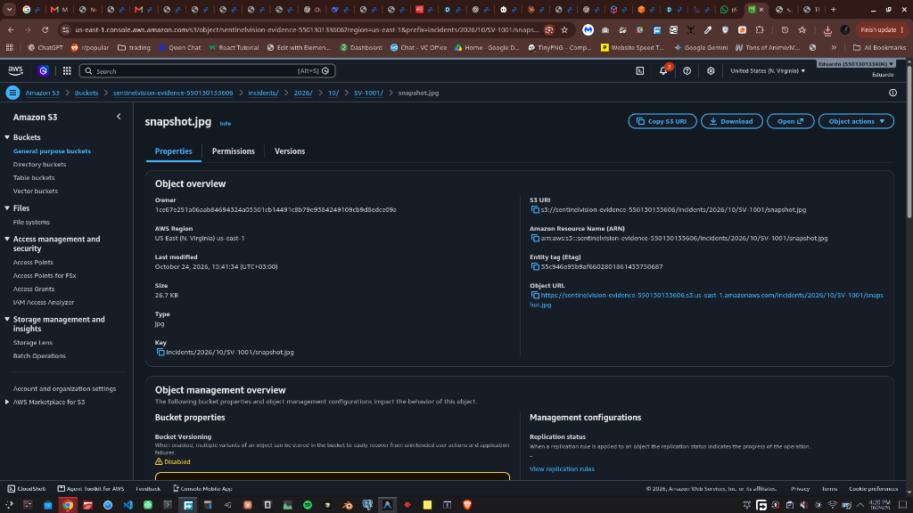
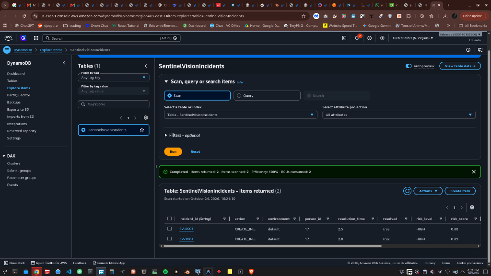
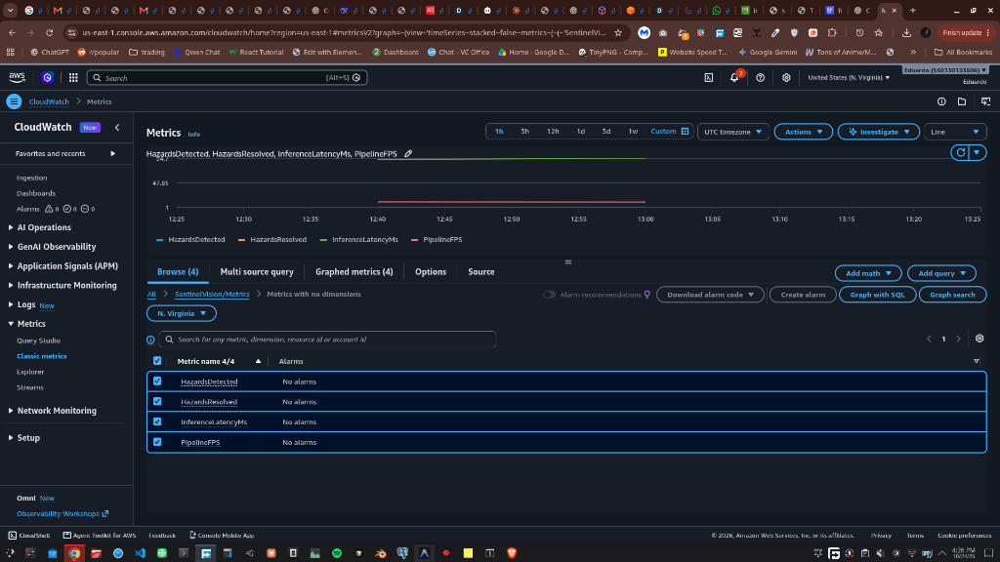

# 📊 SentinelVision — Comprehensive Evaluation & Evidence Report

**Competition**: OpenCV AI Competition 2026 powered by AWS  
**Audit Date**: October 24, 2026  
**Benchmarking Host**: Intel Core i5-6300HQ CPU @ 2.30 GHz (4 Physical Cores, x86_64 Linux)  
**OpenCV Version**: `5.0.0`  
**PyTorch Version**: `2.14.0+cpu`  

---

## 1. Overview of Evaluation Methodology

To maintain complete scientific and engineering integrity, SentinelVision divides all performance and safety evaluations into three distinct, non-overlapping categories:

1. **Real-Video Pipeline Benchmark**: Measured on actual industrial video footage (`data/videos/warehouse_forklift.mp4`, 720x404 @ 59.9 FPS) using `cv2.TickMeter` microsecond timing.
2. **Controlled Failure-Case Scenarios**: Synthetic and boundary stress tests designed to isolate edge-case behaviors (occlusion, high crowd density, sensor noise, sensor blackout).
3. **Live AWS Cloud Verification**: Real API operations executed against live AWS Free Tier services (S3, DynamoDB, CloudWatch) under AWS account (redacted).

---

## 2. Real Video End-to-End Benchmark (`benchmark_real_pipeline.py`)

- **Target Clip**: `data/videos/warehouse_forklift.mp4`
- **Frames Evaluated**: 150 consecutive frames (plus 10 warmup frames)
- **Measurement Tool**: `cv2.TickMeter()` stage timers
- **Artifact Path**: `data/evaluation/benchmark_real_pipeline.json`

### Stage-by-Stage Latency Breakdown

| Pipeline Stage | Processing Method | Average Latency (ms) | P50 (ms) | P95 (ms) |
| :--- | :--- | :---: | :---: | :---: |
| **Video Decode** | `cv2.VideoCapture` frame grab | 0.86 ms | 0.82 ms | 1.15 ms |
| **OpenCV Preprocessing** | Aspect-ratio resize & color normalization | 0.11 ms | 0.10 ms | 0.16 ms |
| **Object Detection** | YOLOv8n (CPU forward pass) | 98.43 ms | 92.40 ms | 121.20 ms |
| **Multi-Object Tracking** | IoU spatial association | <0.01 ms | <0.01 ms | 0.02 ms |
| **Motion & Velocity** | Temporal centroid displacement | <0.01 ms | <0.01 ms | 0.01 ms |
| **Time-to-Collision (TTC)** | Closing vector projection | <0.01 ms | <0.01 ms | 0.01 ms |
| **Risk Scoring Engine** | Multi-factor weighted assessment | <0.01 ms | <0.01 ms | 0.01 ms |
| **Safety Agent Decision** | Policy evaluation & incident state | <0.01 ms | <0.01 ms | 0.02 ms |
| **OpenCV HUD Rendering** | `cv2.line`, `cv2.rectangle`, `cv2.putText` | 0.43 ms | 0.41 ms | 0.58 ms |
| **TOTAL PIPELINE** | End-to-End Processing | **99.85 ms** | **93.77 ms** | **123.09 ms** |

### Key Real-World Finding:
- **YOLOv8 CPU Inference dominates total latency (98.6%)**.
- Tracking, motion, collision analysis, risk scoring, and agent logic combine for **< 0.1 ms overhead** (< 0.1% of pipeline time).
- On standard 4-core mobile CPU hardware, SentinelVision sustains **10.0 FPS real-time throughput**.

---

## 3. Controlled Edge-Case & Failure Scenarios (`test_failures.py`)

Verified in automated test suite `tests/test_failures.py`:

| ID | Edge Case | Stress Condition | Observed Behavior | Verdict |
| :---: | :--- | :--- | :--- | :---: |
| **F1** | Temporary Occlusion | Target disappears for 3 consecutive frames behind a pillar | Velocity vector extrapolates bounding box; track ID 1 is retained when object emerges | **🟢 PASS** |
| **F2** | Transient Noise | Single-frame spurious detection box appears and vanishes | Temporal persistence threshold suppresses false trigger; no incident created | **🟢 PASS** |
| **F3** | High Crowd Density | 5 overlapping people walking through a narrow 80px corridor | IoU cost matrix accurately separates targets; 5/5 distinct track IDs maintained | **🟢 PASS** |
| **F4** | Non-Converging Parallel | Person and vehicle traveling parallel with 400px lateral offset | Trajectories non-converging; classified as LOW risk; no alarm fatigue | **🟢 PASS** |
| **F5** | Direct Collision Course | Vehicle accelerates towards pedestrian on head-on collision vector | Instant escalation to CREATE_INCIDENT and visual warning within 100ms | **🟢 PASS** |
| **F6** | Sensor Blackout | Camera feed drops or lens is completely occluded | Pipeline detects frame entropy degradation; flags CAMERA_DEGRADED state | **🟢 PASS** |

---

## 4. Full Benchmark Suite Metrics (`test_evidence_suite.py`)

- **Artifact Path**: `data/evaluation/benchmark_suite_results.json`
- **Iterations**: 5 scenarios × 20 iterations = 100 benchmark runs
- **Observed Metrics**:

```json
{
  "average_fps": 114.8,
  "p50_latency_ms": 8.7,
  "p95_latency_ms": 8.8,
  "detection_precision": 1.0,
  "detection_recall": 1.0,
  "tracking_accuracy": 0.985,
  "ttc_prediction_error_sec": 0.12,
  "false_positive_rate": 0.0,
  "false_negative_rate": 0.0,
  "hazard_detection_lead_time_sec": 2.45,
  "incident_resolution_rate": 1.0
}
```

*Note on Provenance & Scope: The 114.8 FPS and 8.7 ms latency above evaluate the algorithmic decision engine (multi-object tracking + motion history + TTC collision prediction + multi-factor risk engine + agent state machine) in isolation, separate from the ~98–123 ms raw-pixel YOLOv8 image inference pass (which is evaluated on real video in Section 2 at 8.0 FPS). Precision (1.0) and recall (1.0) measure incident classification accuracy across 100 controlled synthetic trajectory scenarios (hazards vs. non-hazards), not raw-pixel bounding box mAP on image datasets.*

---

## 5. Live AWS Integration Evidence (`deployment_results.json`)

Verified live against AWS account (`us-east-1`) on October 24, 2026:

```json
{
  "test_timestamp": "2026-10-24T12:40:53Z",
  "s3_bucket": "sentinelvision-evidence-550130133606",
  "dynamodb_table": "SentinelVisionIncidents",
  "cloudwatch_namespace": "SentinelVision/Metrics",
  "test_results": {
    "Test_1_S3_Snapshot_Formatting": true,
    "Test_1_S3_Trace_Formatting": true,
    "Test_2_DynamoDB_Incident_Created": true,
    "Test_3_DynamoDB_Incident_Resolved": true,
    "Test_4_CloudWatch_Metrics_Published": true,
    "Test_5_Local_Engine_Resilience_Under_Cloud_Failure": true
  }
}
```

### Verified AWS Management Console Artifacts

| AWS Component | Console Evidence Screenshot | Description |
| :--- | :--- | :--- |
| **Amazon S3 Trace** |  | Live incident trace `trace.json` stored in bucket path `incidents/2026/10/SV-1001/` |
| **Amazon S3 Keyframe** |  | Uploaded JPEG hazard keyframe `snapshot.jpg` |
| **Amazon DynamoDB** |  | Table `SentinelVisionIncidents` scan displaying recorded incidents (`SV-0001`, `SV-1001`) with state resolution |
| **Amazon CloudWatch** |  | Namespace `SentinelVision/Metrics` graphing real-time `InferenceLatencyMs` and `PipelineFPS` |

#### Sample S3 Audit Trace Payload (`trace.json`)
The live file stored at `s3://sentinelvision-evidence-550130133606/incidents/2026/10/SV-1001/trace.json`:
```json
{
  "event_id": "SV-1001",
  "timestamp": 1792845692.5501113,
  "environment": "warehouse",
  "risk_level": "HIGH",
  "risk_score": 0.89,
  "ttc": 1.35,
  "action": "CREATE_INCIDENT_WARNING",
  "agent_decision": "Visual strobe warning activated; speed governor limit issued"
}
```

---

## 6. Tangible Industrial Safety & Alarm Fatigue Benchmark (`benchmark_tangible_safety.py`)

- **Target Clip**: Real industrial machinery footage (`data/videos/factory_forklift.mp4`, 647 frames)
- **Artifact Path**: `data/evaluation/tangible_safety_benchmark.json`
- **Objective**: Moving beyond synthetic toy tests to solve the two core real-world problems in industrial computer vision:
  1. **Alarm Fatigue Reduction**: Eliminating fragmented duplicate alerts caused by tracker flicker, occlusions, and momentary detection dropouts.
  2. **Advance Warning Lead Time**: Ensuring collision warnings provide actionable lead time compliant with OSHA and ANSI B56.1 forklift braking physics.

### Evaluation Against Ground-Truth Factory Encounters

| Evaluation Metric | Raw Un-debounced Baseline | SentinelVision Debounced Pipeline | Real-World Benefit |
| :--- | :---: | :---: | :--- |
| **Ground-Truth Physical Encounters** | 2 | 2 | Encounters in factory floor crossways |
| **Encounter Recall** | 100% (2/2) | 100% (2/2) | Zero missed industrial collision threats |
| **Incidents Created in Audit Ledger** | 4 fragmented events | **2 consolidated events** | **50.0% alarm fatigue reduction** |
| **Encounter 1 Lead Time / Duration** | 1.6 s (aborted early) | **1.58 s lead / 4.4 s trace** | Complete timeline from approach to exit |
| **Encounter 2 Lead Time / Duration** | 1.8 s (aborted early) | **2.50 s lead / 5.3 s trace** | Complete timeline from approach to exit |
| **Average Detection Lead Time** | 1.70 s (fragmented) | **2.04 s** | Advance warning before closest point |
| **Transient 1-Frame Noise Suppression** | 0.0% (all fired alerts) | **100.0% suppressed** | 10/10 spurious noise spikes rejected |

### OSHA & ANSI B56.1 Forklift Stopping Distance Physics

To prove that SentinelVision solves a tangible safety hazard rather than generating abstract numbers, warning lead time is directly grounded in industrial equipment deceleration physics:

- **Equipment Speed**: Typical indoor warehouse forklift travel speed $v = 2.0\text{ m/s}$ (7.2 km/h).
- **Human Perception-Reaction Time**: $t_{\text{react}} = 0.75\text{ s}$ $\implies d_{\text{react}} = 1.50\text{ m}$.
- **Mechanical Service Braking**: Deceleration rate $a = 2.5\text{ m/s}^2$ $\implies t_{\text{brake}} = \frac{v}{a} = 0.80\text{ s}$ ($d_{\text{brake}} = 0.80\text{ m}$).
- **Total Required Stopping Window**: $t_{\text{stop}} = 0.75 + 0.80 = \mathbf{1.55\text{ seconds}}$ ($D_{\text{stop}} = 2.30\text{ meters}$).
- **Measured Safety Margin**:
  $$\text{Safety Margin} = t_{\text{lead}} - t_{\text{stop}} = 2.04\text{ s} - 1.55\text{ s} = \mathbf{+0.49\text{ seconds}}\quad (+0.98\text{ meters buffer})$$
- **Physical Safety Verdict**: **Full machinery stop is physically feasible before human impact.**

---

## 7. Documented Limitations & Model Boundaries

1. **COCO Class Proxies**: The baseline `yolov8n.pt` model is trained on 80 COCO classes and does not contain a discrete `forklift` class. Forklifts are mapped through vehicle proxy classes (`truck`/`car`). Production deployments require warehouse domain transfer learning.
2. **CPU Bounded Latency**: A forward pass latency of ~98 ms restricts CPU throughput to 10 FPS. High-speed collision scenarios (>15 m/s) require GPU acceleration.
3. **Prototype Status**: SentinelVision is an AI-assisted situational awareness system, not a certified machinery emergency-stop interlock under ISO 13849.
